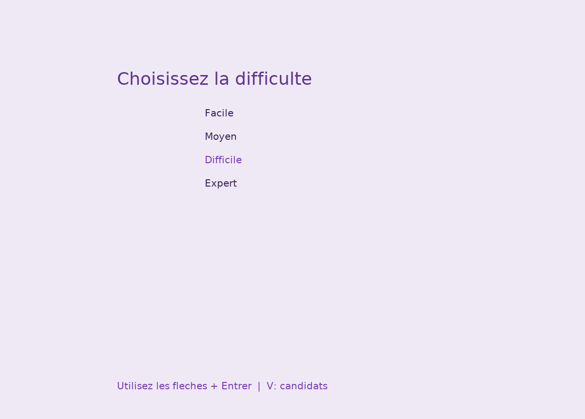
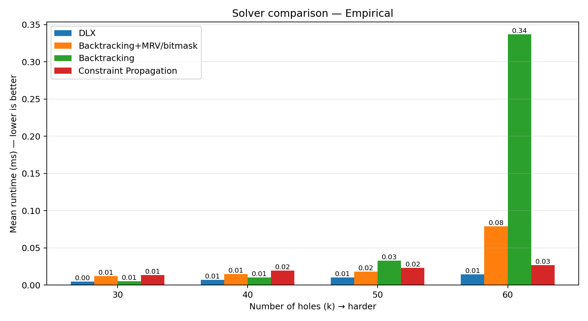
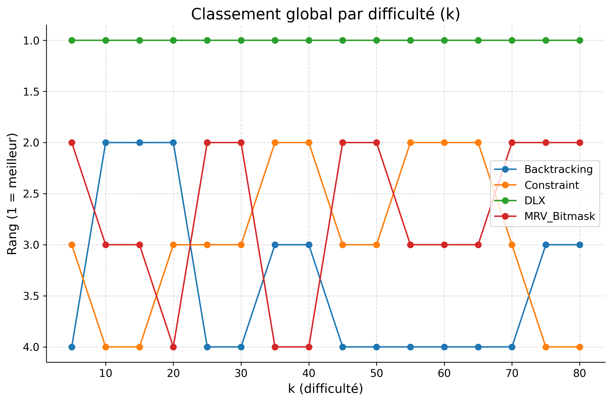

# Sudoku — CLI & GUI (C / SDL2)
[](https://github.com/odebrino/sudoku/actions/workflows/ci.yml)
Complete Sudoku application in C with a CLI, SDL2 GUI, multiple solvers,
and a generator that enforces uniqueness.

## Features
- CLI generate/solve/print with solver selection.
- SDL2 GUI with hint, trace, save/load, undo/redo.
- Solvers: DLX (Algorithm X), backtracking, MRV + bitmask, constraint propagation.
- Benchmark/plots tooling and datasets.

## Screenshots


## Benchmarks



## Requirements
- C compiler with C11 support and `make`.
- SDL2 + SDL2_ttf (for GUI).
- `pkg-config` (recommended for SDL2 flags).
Note: the GUI bundles DejaVu Sans in `assets/fonts/` (see its license file).

On Ubuntu/Debian:
```bash
sudo apt-get update
sudo apt-get install -y libsdl2-dev libsdl2-ttf-dev
```

## Build
```bash
make cli
make gui
make bench
```

## Tests
```bash
make test
BF_TRIALS=200 make test-bf   # heavy brute-force run
```

## CLI usage
```bash
./build/sudoku_cli --generate 40 > k40.txt
./build/sudoku_cli --solve k40.txt --solver mrv
./build/sudoku_cli --solve - --solver dlx
```
`--solver` accepts: `auto`, `dlx`, `bt`, `mrv`, `cp`.
`--generate <k>` expects `k` in `0..60` for unique puzzles.

## Reproducibility
You can fix the RNG seed via env var or CLI:
```bash
SEED=123 ./build/sudoku_cli --generate 40 > k40.txt
./build/sudoku_cli --generate 40 --seed 123 > k40.txt
```

## GUI usage
```bash
./build/sudoku_gui
```
Keys: **H** (hint), **S** (solve), **B** (trace), **K** (save), **L** (load), **N** (new).

## Project structure
```
include/            # headers
src/utils/          # grid, io, rand, trace
src/solvers/        # dlx, backtracking, mrv_bitmask, constraint_propagation, rules
src/generator/      # generator
src/interface/      # cli, formatter, save, gui, gui_draw, gui_events, gui_solver
scripts/            # plotting/benchmark helpers
data/               # datasets and save.json
results/            # benchmark outputs
plots/              # generated charts
```

## CLion
Open the folder as a Makefile project (CLion auto-detects `Makefile` targets).

## Artifacts
Generated plots/results are tracked for convenience. See `docs/ARTIFACTS.md`.

## License
MIT. See `LICENSE`.
