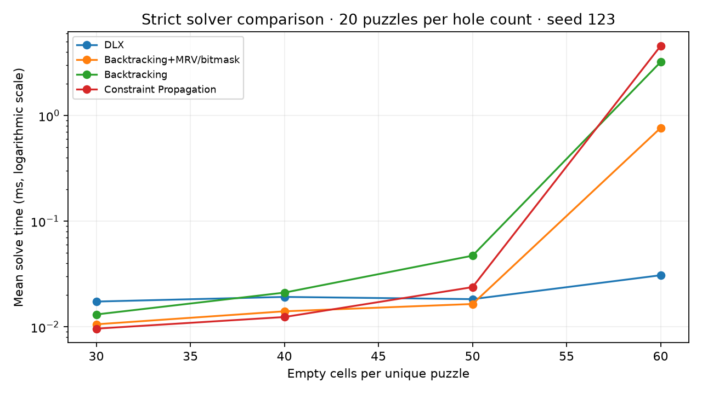

# Sudoku — C solvers, CLI, and SDL2 GUI

[](https://github.com/odebrino/Sudoku_CLI_-_SDL2_GUI/actions/workflows/ci.yml)

A C11 application comparing four Sudoku solvers through a shared grid API. The generator checks uniqueness with capped exact-cover search; the CLI and SDL2 GUI use the same solver and generator modules.


Original project credits: **Rafael Ode Brino and Maria Eduarda Rizo**, retained from the MIT license. The release preparation adds strict solver validation, a constraint-propagation regression fix, reproducible benchmark records, and CLI/GUI CI. [Tagged releases](https://github.com/odebrino/Sudoku_CLI_-_SDL2_GUI/releases).

## Try the CLI

Requires a C11 compiler and Make; SDL2 is optional. From a clone:

```bash
make cli
./build/sudoku_cli --generate 40 --seed 123 > build/puzzle.txt
./build/sudoku_cli --solve build/puzzle.txt --solver mrv
SEED=123 make test
```

`k` means **number of empty cells**, from 0 to 60. Generation succeeds only when exactly `k` cells are empty and the puzzle has one solution; a hole count is not a calibrated difficulty rating. Solvers are `auto`, `dlx`, `bt`, `mrv`, and `cp`. Input accepts 81 digits (`0` or `.` for blanks), with whitespace allowed. `--solve -` reads stdin.

## Algorithms and structure

| Solver | Approach | Tradeoff |
| --- | --- | --- |
| DLX | Algorithm X / dancing links over 324 exact-cover constraints | Shared exact-cover basis for solving and uniqueness counting |
| Backtracking | Recursive search; the shared empty-cell helper counts candidates | Simple reference implementation, although it already uses a cell-selection heuristic |
| MRV + bitmask | Minimum remaining values with row/column/box masks | Maintains compact availability masks during search |
| Constraint propagation | Naked singles followed by branching | Restores every propagated assignment when a branch fails |

`src/solvers/` and `src/generator/` operate on `Grid`; `src/interface/` contains CLI, GUI, tracing, and save/load presentation. DLX and constraint propagation use internal static state and are intended for sequential calls, not concurrent solves.

`make test` runs a puzzle that previously broke propagation rollback, compares all four solvers with the unique exact-cover solution, checks seeded generation, and validates 20 puzzles at each of 30/40/50/60 holes. Every solver must return success, complete every row/column/box, and preserve clues. There is no fallback solver in this comparison.

## Run the GUI

On Ubuntu/Debian install `build-essential pkg-config libsdl2-dev libsdl2-ttf-dev`, then:

```bash
make gui
./build/sudoku_gui
```

H: hint · C: check · S: solve · B: trace · X: clear trace · N: new/menu · Z/Y: undo/redo · K/L: save/load. The interface labels are French. A genuine game screenshot can be reproduced without a display:

```bash
SDL_VIDEODRIVER=dummy GUI_SCREENSHOT=build/gui.bmp GUI_SCREENSHOT_MODE=game GUI_SCREENSHOT_K=50 SEED=123 ./build/sudoku_gui
```

The renderer falls back to software when acceleration is unavailable, and screenshot failures produce a nonzero exit status. CI compiles with GCC and Clang and separately builds SDL2 and exports this screenshot.

## Reproducible solver comparison

```bash
python3 scripts/benchmark_repro.py --seed 123 --trials 20
```

This writes summary/raw CSV, the exact puzzle corpus, and machine/compiler metadata to `build/benchmarks/`. Build from a clean tree when changing compiler flags (`make clean`); the script records the requested compiler and flags. Seeds use C `rand()`, so a fixed seed reproduces a corpus within the same libc implementation; compare corpus hashes across environments.

[Recorded comparison and limitations](docs/benchmarks/README.md) · [raw timings](docs/benchmarks/raw.csv) · [exact puzzles](docs/benchmarks/corpus.csv).



These are local single-solve wall times, not a universal ranking. Generated puzzles are a small corpus, and timer/process noise matters at these durations. Historical `plots/` and `results/` predate the strict harness and may have used a fallback that masked solver failures; they are retained as historical artifacts and are not the featured evidence.

## License

Code: [MIT](LICENSE), with the original contributors credited. The bundled DejaVu Sans font retains its [separate license](assets/fonts/DejaVuSans-LICENSE.txt). The Linux release archive contains the CLI; build the GUI from tagged source with the SDL2 dependencies above.
